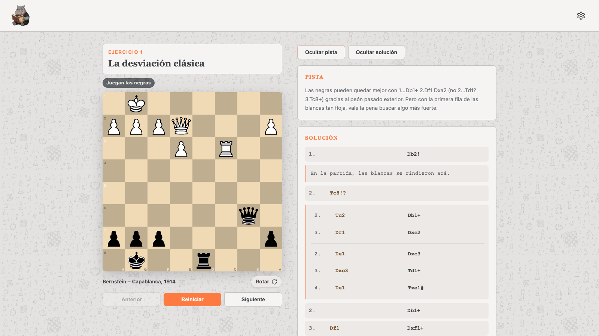
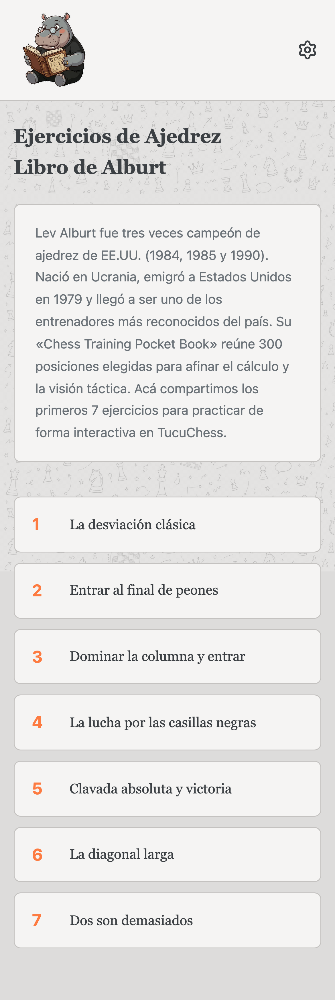
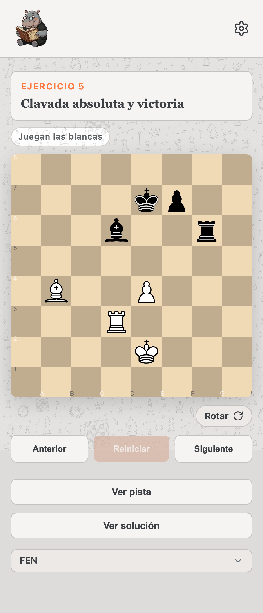
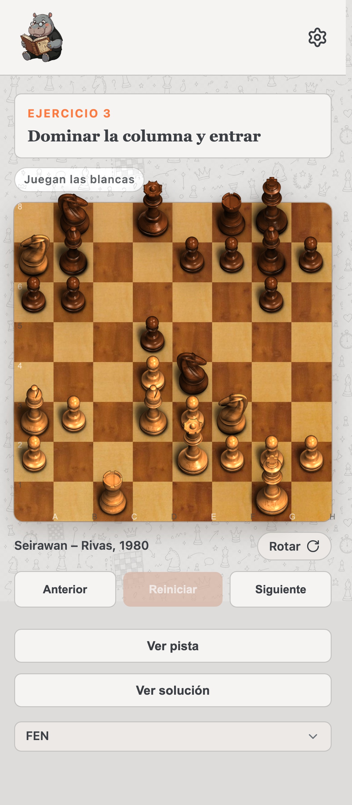

# Ejercicios de Alburt

> Este proyecto fue codeado en forma black box con IA como proyecto personal. No es un repositorio pensado para evaluación de recruiters ni como muestra representativa de ingeniería profesional.

Aplicación web estática para practicar ejercicios tácticos de ajedrez basados en el _Chess Training Pocket Book_ de Lev Alburt. El proyecto ofrece un índice con los ejercicios disponibles y una vista interactiva para resolver cada posición sobre un tablero.

## Demo

<p align="center">
  <a href="https://libasoles.github.io/alburt-exercises/">
    
  </a>
</p>

<p align="center">
  <a href="https://libasoles.github.io/alburt-exercises/"><strong><span style="font-size: 1.25rem;">Ver ejercicios</span></strong></a>
</p>

## Capturas

### Desktop



### Mobile







## Stack

- Vite
- JavaScript ES modules
- [`lichess-org/chessground`](https://github.com/lichess-org/chessground)
- `chess.js`
- Vitest

## Desarrollo

### Requisitos

- Node.js 18+
- npm

> Para que la IA pueda extraer ejercicios, el libro en PDF debe existir dentro de la carpeta `/references`, que no se versiona en git.

### Instalar dependencias

```bash
npm install
```

### Levantar en local para desarrollo

```bash
npm run dev
```

### Ejecutar tests

```bash
npm test
```

### Generar build

```bash
npm run build
```

## Deploys (Continuos Delivery)

Deploy automático con GitHub Actions. Ver [`.github/workflows/deploy-pages.yml`](/Users/guillermoperez/Projects/playground/chess/alburt-book/.github/workflows/deploy-pages.yml). El flujo:

## Estructura

```text
.
├── index.html (página)
├── exercise.html (página)
└── src/
    ├── exercise.js
    ├── main.js
    ├── exercises/
    └── styles/
├── public/images/ (assets)
```

La estructura de los ejercicios se define en el archivo:
`src/exercises/data.js`

## Componentes y assets

- El tablero interactivo está construido sobre [`lichess-org/chessground`](https://github.com/lichess-org/chessground).
- El tema plano usa los assets `cburnett` importados desde `chessground`.
- Las piezas del tema Staunton incluidas en `public/images/staunton/` provienen de [`lichess-org/lila`](https://github.com/lichess-org/lila).

## IAs

Hay una Skill casera con instrucciones para extraer ejercicios del PDF en: `.claude/skills/extract-alburt-exercises/SKILL.md`.

En esa carpeta, la skill es solo accesible para Claude, pero se puede mover a `.agents` y probarla con otro agente.
